# Dùng thử và cải thiện Âm

Ngày 22/10/2026. Chromium local; luồng thực tế bắt đầu từ trình duyệt mới. Ảnh trong báo cáo được chụp mới trong lượt đánh giá này, lưu và mở xem trước khi sử dụng.

Đánh giá: dùng ổn để ôn và nhớ quy tắc phát âm. Các điểm làm đứt mạch học đã được sửa. Phần thực hành nói vẫn phụ thuộc audio của thiết bị và chưa đo được chất lượng phát âm của người học.

## Hành trình đã thử

### 1. Bắt đầu phiên học — Tốt

Nút bắt đầu nổi bật, lộ trình theo chủ đề rõ. Trạng thái điều hướng trước đây không được chọn khi vào bài qua “Bắt đầu phiên học”; đã sửa.

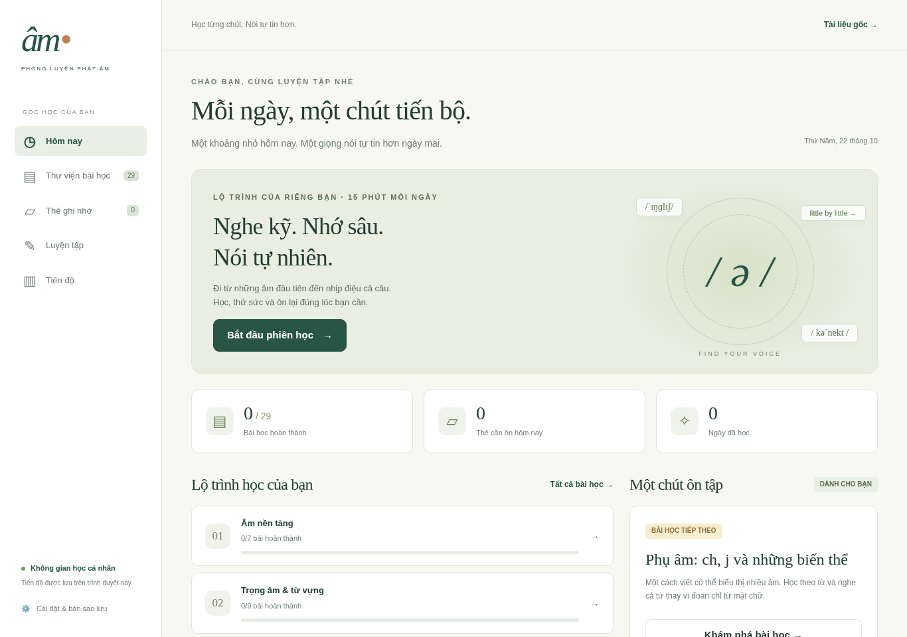

### 2. Đọc bài học trên điện thoại — Đã cải thiện

Mức vừa: khối thao tác chiếm màn hình đầu trước quy tắc. Đã đưa nội dung lên trước và thêm nút “Tới phần luyện tập”. Chữ IPA và giải thích được tăng kích thước.

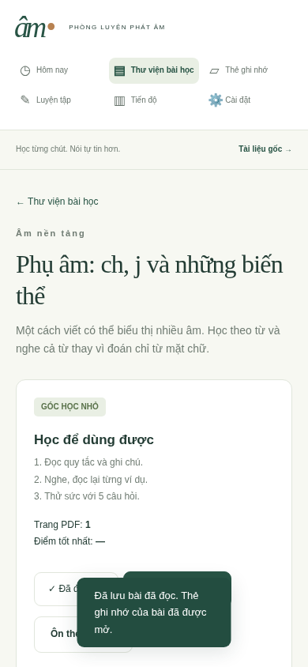

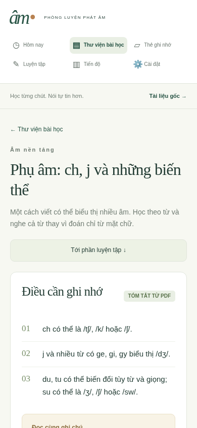

### 3. Làm bài → mở bài học → quay lại luyện — Đã sửa lỗi làm gián đoạn

Mức cao: ở câu 2/5, mở bài học rồi chọn Luyện tập sẽ mất đường tiếp tục phiên. Đã giữ phiên trong bộ nhớ, thêm khối “Phiên luyện đang dở” và nút quay lại trong bài học. Kiểm tra lại đúng câu, đáp án đã chọn và giải thích. Phiên đang dở chỉ được giữ khi chuyển trang trong cùng lượt mở website; chưa khôi phục sau tải lại/đóng tab.

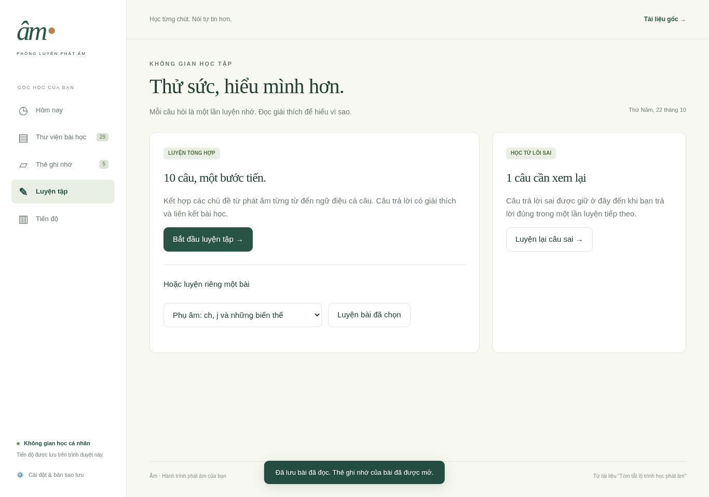

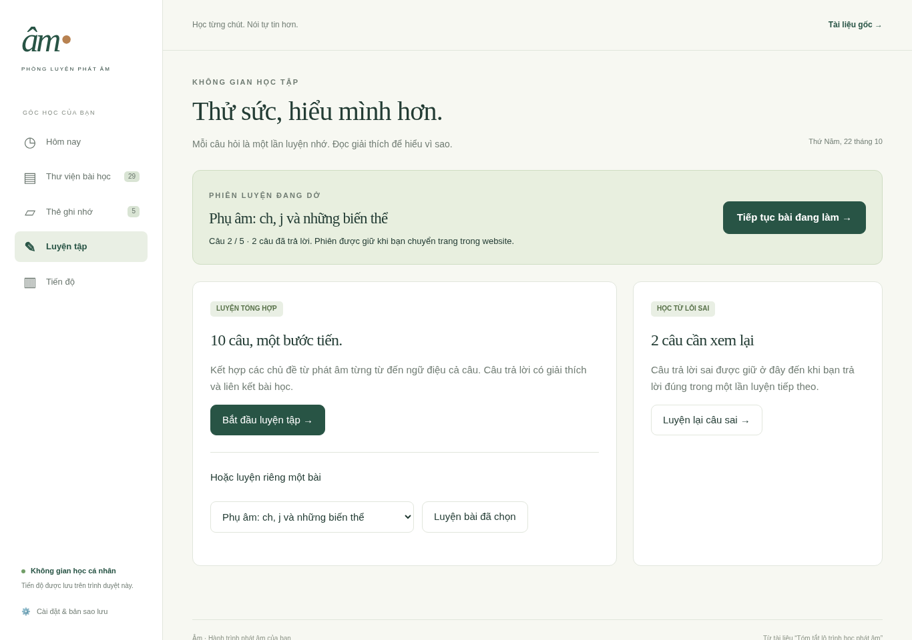

### 4. Ôn thẻ và xem lịch tiếp theo — Đã cải thiện

Mức vừa: chữ phụ của nút “Đã nhớ” tương phản thấp; đã tăng độ tương phản. Màn hình kết thúc nay hiện ngày giờ ôn tiếp và nút đi tiếp lộ trình, thay vì chỉ quay về thư viện.

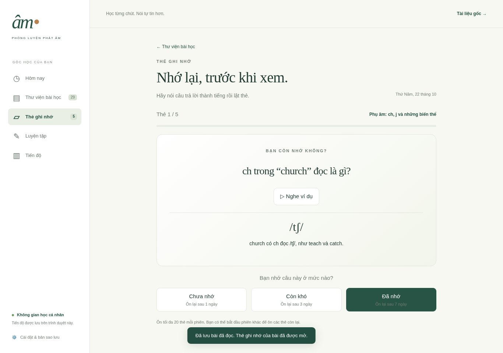

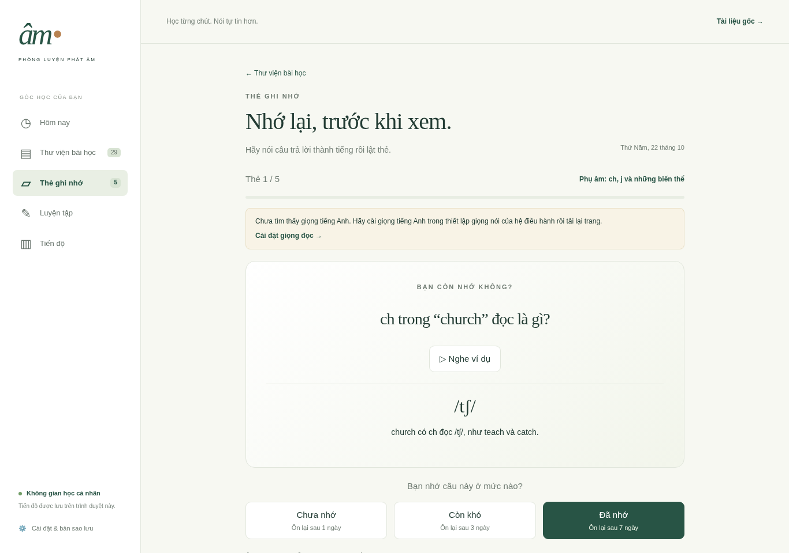

### 5. Nghe ví dụ và xử lý thiếu giọng — Đã cải thiện; còn giới hạn audio

Mức vừa: nút chỉ khoảng 30 × 33 px, thiếu nhãn dễ nhận biết; khi thiếu giọng, toast che ví dụ. Đã đổi thành “Nghe”, tối thiểu 70 × 44 px, đặt hướng dẫn cố định trong bài và liên kết Cài đặt. Máy kiểm tra thiếu giọng tiếng Anh nên chưa xác nhận được âm thanh thực bằng nghe.

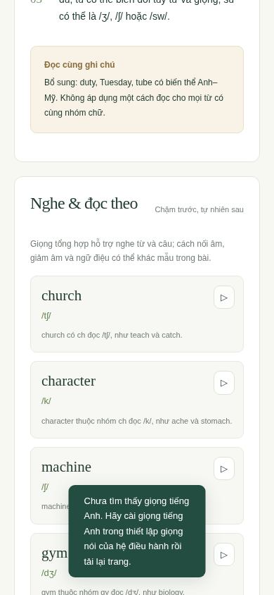

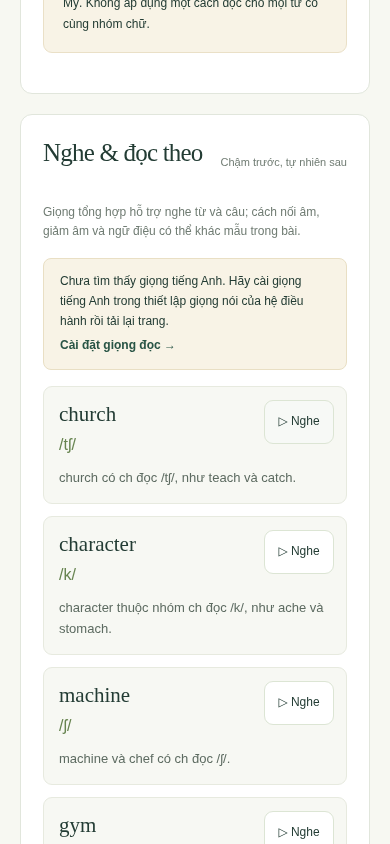

Bài học desktop: điều hướng đang chọn và hướng dẫn giọng đọc.

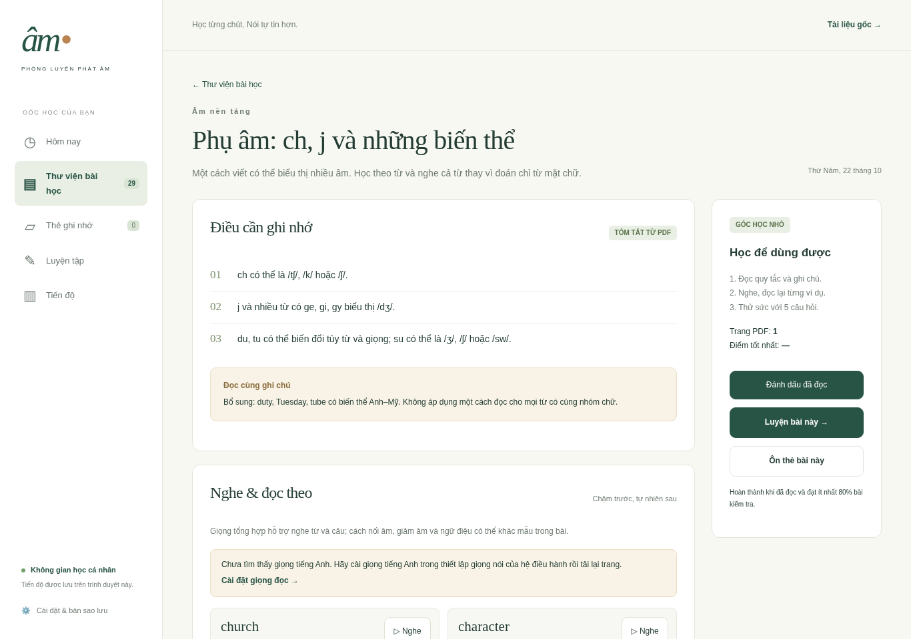

Đáp án và giải thích sau khi trả lời: giữ màu và chữ rõ thay vì làm mờ toàn bộ nút.

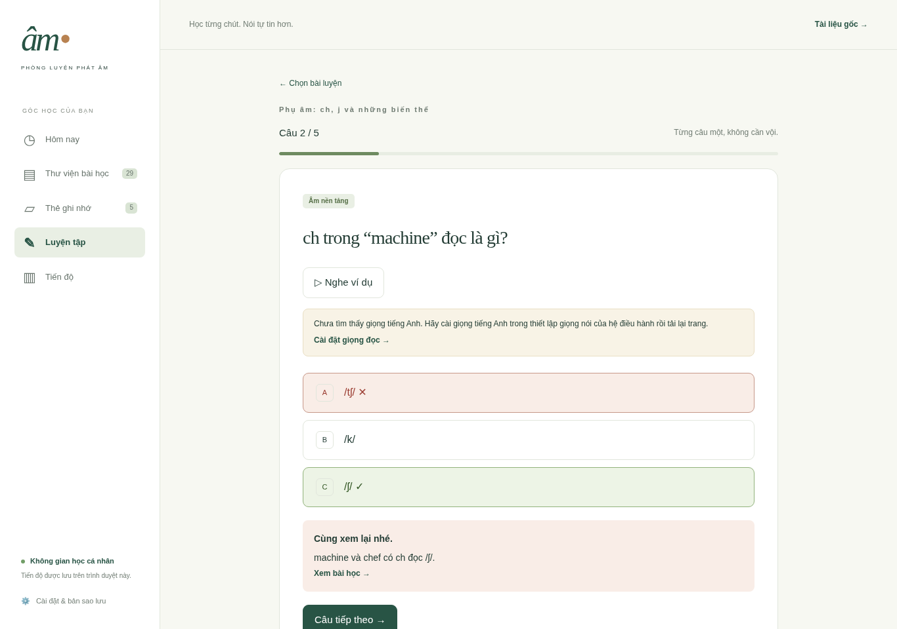

Hoàn thành phiên ôn: ngày giờ tiếp theo và nút học tiếp.

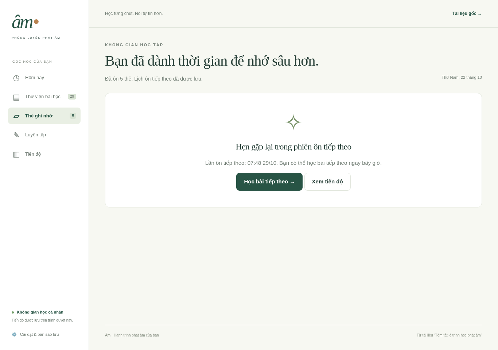

Câu hỏi kế tiếp trên mobile: đưa câu hỏi vào vùng nhìn thấy và chuyển focus.

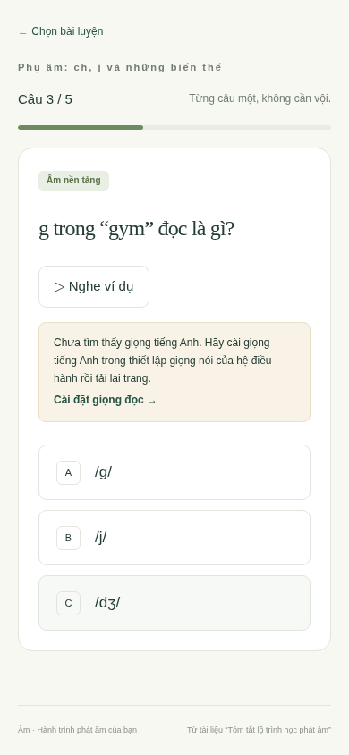

## Kết quả kiểm tra

Đạt 4 nhóm kiểm tra dữ liệu/logic, toàn bộ kiểm tra tích hợp cũ và kiểm tra UX mới. Kiểm tra UX xác nhận tiếp tục đúng phiên, nút nghe ít nhất 44 px, bài học mobile ưu tiên nội dung, ngày ôn tiếp, câu hỏi mới nằm trong màn hình và nhận focus, không tràn ngang trên 24 tổ hợp trang/kích thước (320, 390, 768, 1366 px). Không có lỗi JavaScript trong các lượt cuối.

## Giới hạn đánh giá

Chưa kiểm tra thiết bị thật, Safari/Firefox, trình đọc màn hình hoặc khả năng tiếp thu qua nghiên cứu người dùng. Các kiểm tra kích thước và focus không tương đương chứng nhận WCAG. Chưa kiểm chứng chất lượng TTS thực tế vì môi trường không có giọng tiếng Anh. Tài liệu giữ các ghi chú về ngoại lệ và khác biệt giọng.

## Ưu tiên tiếp theo

Ưu tiên tiếp theo: audio từ nguồn phát âm đáng tin cậy, nghe phân biệt các cặp âm dễ nhầm, luyện câu và tự so sánh bản đọc. Các bài hiện tại chủ yếu kiểm tra nhận diện quy tắc; điểm cao chưa chứng minh phát âm tốt. Các hạng mục này là đề xuất, chưa triển khai trong lượt sửa này.
